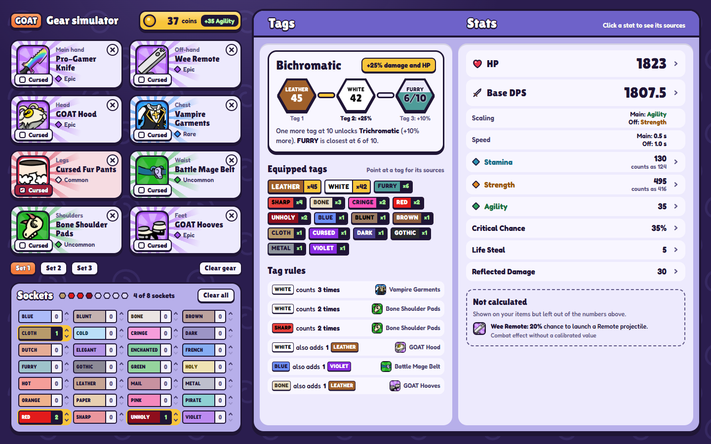

# GOAT Gear Simulator

A local gear stat simulator for
[GOAT: Gear Optimization AutoBattle Tactics](https://store.steampowered.com/app/3601690/GOAT_Gear_Optimization_AutoBattle_Tactics/)
(GOAT for short). Pick up to eight items, mark slots as cursed, enter
coins and socket tags, and see the exact stats, tags and chromatic bonus, with where every
number comes from. Pointing at an item in the picker previews how the stats would change.

**The game math is in [RULES.md](RULES.md):** the formulas, calculation order, catalog
conventions and known limitations.

This is an unofficial fan project, not affiliated with the makers of GOAT.



## Limitations

- The catalog has 221 items, the ones unlocked so far. It doesn't contain every item in the
  game yet.
- The layout needs a window at least 1024 px wide; it isn't made for phones.
- It's a stat simulator, not a battle simulator: combat effects such as procs, block and
  missing-HP bonuses aren't calculated (see RULES.md §7).

## Getting started

Prerequisites: Node 24 and pnpm 12 (`npm install -g pnpm@12`, or `corepack enable`).

```sh
pnpm install
pnpm dev        # http://localhost:5173
```

The app runs locally only. Your three gear sets (switch with the Set 1/2/3 buttons) are saved in
the browser's localStorage. Each set has its own gear and sockets; coins are shared. With the app
open in several tabs, a change in one tab shows up in the others, and each tab stays on its own
set. If the browser can't save, or a save can't be loaded, the app shows a notice with a way to
try again.

| Script | What it does |
|---|---|
| `pnpm dev` | Starts the dev server |
| `pnpm build` / `pnpm preview` | Builds the app into `dist/` and serves the build |
| `pnpm verify` | Lint, type check, catalog check, tests and a production build: everything CI runs |
| `pnpm test` | Runs the tests |
| `pnpm lint` / `pnpm format` | Checks or fixes formatting and lint findings (Biome) |
| `pnpm typecheck` | Type checks the app (browser) and the scripts and tests (Node) |
| `pnpm catalog:check` | Validates `items.json`, the item icons and the generated schema |
| `pnpm schema` | Regenerates `items.schema.json` from the zod schema |

## Project structure

| Path | Purpose |
|---|---|
| [RULES.md](RULES.md) | The game rules the simulator implements |
| [items.json](items.json) | The 221 catalog items with their stats and effects |
| [items.schema.json](items.schema.json) | JSON Schema of the catalog, generated by `pnpm schema` |
| [public/icons/](public/icons/) | Item icons, one per item |
| [src/catalog/](src/catalog/) | zod schema (the source of truth for the format), loader and integrity checks |
| [src/engine/](src/engine/) | The calculation engine: pure TypeScript following RULES.md, with the reference tests |
| [src/state/](src/state/) | Zustand stores: the three saved gear sets (with load-time sanitizing, failure-safe saving and tab sync) and the picker |
| [src/ui/](src/ui/) | React components: gear column, results sheet and item picker |
| [scripts/](scripts/) | Catalog check and schema generation, run directly by Node |

Stack: Vite, React 19 with the React Compiler, TypeScript, Tailwind CSS, Base UI, zod,
Zustand, Vitest and Biome.

## License

The source code is under the [MIT License](LICENSE). GOAT, its item names and texts and the
item icons in `public/icons/` belong to their respective rights holders and aren't covered by
the license.
